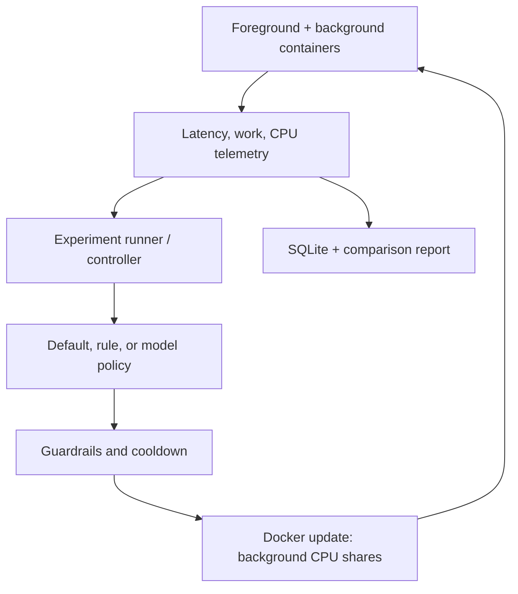

# Adaptive OS Controller — Docker MVP Development Spec

**Status:** implementation brief  
**Date:** 2026-09-29  
**Audience:** coding agent implementing a reproducible feasibility experiment

## 1. Objective

Build a small controller that observes two Linux workloads competing for CPU, changes their relative CPU allocation, and measures whether a foreground periodic task becomes more responsive at an acceptable cost to background work. Compare three policies on the same benchmark:

1. Docker/Linux default CPU shares.
2. A deterministic rule that reduces the background container's CPU shares when the foreground task is struggling.
3. A local decision model (Laya), initially in shadow mode and then in live mode if the earlier stages work.

The outcome is an experiment report, including negative or inconclusive results. The controller must never claim that AI improved scheduling solely because it chose a different action. The CPU scheduler remains the kernel's scheduler; the controller changes one of its resource-allocation inputs.

### Boundary that must be explained in the product and README

Linux containers share the kernel of their Docker host. On **Docker Desktop for macOS**, that host is Docker's Linux VM, not the macOS kernel. This MVP changes the CPU shares of **the experiment's containers inside that VM**. It cannot change the scheduling of a native macOS Zoom/Meet call or native macOS build. A later host-level Linux implementation is a separate milestone. Do not use a privileged container or mount the Docker socket into a container: the controller runs on the machine invoking the Docker CLI and acts only on containers it created.

## 2. Development environment

- **Recommended first setup:** Docker Desktop on Mac, with at least two CPUs and 4 GiB assigned to its Linux VM, or Docker Engine on an Ubuntu 24.04 LTS Linux host. Ubuntu is optional; the kernel is supplied by the Docker host/VM, not by a container image.
- **Container userland:** `python:3.11-slim-bookworm`, pinned by digest when implementation begins. Use one image for both workloads; do not interpret its Debian version as a different kernel.
- **Host controller:** Python 3.11+, Docker CLI and Compose plugin if useful. Prefer `subprocess.run([...])` with argument arrays for Docker commands. A Compose file is optional; the runner may create containers using the Docker CLI to simplify dynamic updates and cleanup.
- **Model integration:** Laya behind a small local adapter. Make the adapter swappable; Jev may be used as an optional offline comparison. Neither model is required for the first feasibility gate.
- **Permissions:** access to the local Docker daemon. Treat this as administrative access. The container workloads do not require `--privileged`, `--pid=host`, host networking, or a Docker socket mount.
- **No real video call initially.** A controlled periodic workload provides reproducible scheduling latency measurements. Label it **synthetic foreground workload**, never “video call quality.”

### Preflight checks

The agent must automate and record:

```bash
docker version
docker info --format '{{.OSType}} {{.CgroupVersion}}'
docker run --rm python:3.11-slim-bookworm python -c 'import os; print(sorted(os.sched_getaffinity(0)))'
docker run --rm python:3.11-slim-bookworm sh -c 'cat /proc/pressure/cpu; cat /sys/fs/cgroup/cpu.weight'
```

Select the **first CPU in the returned affinity list**, not hard-coded CPU 0. If Docker uses cgroup v1, or `cpu.weight`/PSI is missing, report an explicit unsupported or degraded mode rather than pretending the v2 telemetry exists. Confirm that both workloads can be pinned to the same permitted CPU. Host/VM power saving, thermal throttling, other heavy processes, and Docker Desktop VM CPU settings can affect results; record the environment.

### Manual control smoke test before writing the controller

Create a background container pinned to the selected CPU and run a long CPU-bound process. Read its initial `cpu.weight` if available; execute `docker update --cpu-shares 128 <owned-container>`; verify both `docker inspect`'s `HostConfig.CpuShares` and the effective cgroup weight; then restore `--cpu-shares 1024` and remove the container. Docker's `--cpu-shares` is a **relative, soft weight**, not a CPU cap or a reserved percentage. It has an observable effect only during contention. The controller must use Docker's API/CLI rather than write arbitrary cgroup paths inside the VM.

## 3. Architecture and control loop



**Control plane:** a host-side controller samples metrics every second and considers a policy decision once per 5-second window. **Data plane:** Linux schedules threads continuously according to its own rules and the containers' relative weights. Never call an AI service on each context switch or scheduling event.

### Workloads

**Foreground:** one process pinned to the chosen CPU. Every configurable period (initially 20 ms), it wakes, performs configurable CPU work, and records scheduled wake time, actual wake time, completion time, and whether it met its deadline. Emit timestamped structured JSON lines and an aggregate every second. Use `time.monotonic_ns()` for intervals; never use wall-clock time for latency calculations. Start with an easy load, then increase work per period until default scheduling shows measurable contention. Report the configured work budget and actual CPU utilization so a stress test is not presented as a realistic call.

**Background:** one continuously CPU-bound process pinned to the same CPU. Count completed deterministic work units (e.g., fixed-size hashes) and report work units per second; include a checksum to prevent accidentally measuring an optimized-away loop. Its baseline CPU shares are 1024. Do not combine `--cpus` quota with share tuning in the MVP; a hard quota would confound the experiment.

**Why pin both:** on a many-core machine there might otherwise be no contention, and a share change could appear ineffective. A second no-contention scenario should run on separate CPUs or with lower total demand and should show that the rule leaves the background at baseline.

### Metrics and policy contracts

```text
State sampled per window:
  foreground_p95_completion_lateness_ms
  foreground_deadline_miss_rate
  foreground_p95_wakeup_delay_ms
  background_work_units_per_second
  foreground_cpu_percent, background_cpu_percent
  cpu_pressure_some_delta (if accessible)
  current_mode, elapsed_since_last_change_sec, data_age_sec

Allowed modes:
  balanced          -> background --cpu-shares 1024
  favor_interactive -> background --cpu-shares 128

Optional mode after first gate:
  favor_build       -> background --cpu-shares 2048
```

Define **completion lateness** as `max(0, completion_time - scheduled_deadline)`; also record end-to-end completion time from scheduled wake. A p95 of lateness can be zero even if some deadlines are missed, so always report miss rate as well. Exclude warm-up seconds and invalid windows from policy comparisons. `cpu.pressure` is supporting context, not the sole outcome metric.

**Rule policy, first iteration:** if two consecutive valid 5-second windows have foreground miss rate above 2% *and* the background is consuming substantial CPU, choose `favor_interactive`. If three consecutive valid windows have miss rate below 0.5%, choose `balanced`. Apply a 10-second minimum dwell time and a 30-second cooldown after a change. These thresholds are starting configuration values, not established optimal settings; freeze them before comparison runs and record them in the report. When data is missing/stale for two windows, the background exits, Docker reports an error, or a trial ends, restore 1024. Avoid oscillation.

**Laya adapter:** input is compact, rounded state data plus two allowed action labels. Require valid schema and log model ID, confidence, latency, and full allowed-action mapping. The deterministic guardrails validate any answer; invalid, late, or unavailable responses map to `balanced`. In shadow mode, record proposed actions without applying them. For live model comparisons, make decisions on the same 5-second cadence and keep the same cooldown, bounds, fallback, and metrics as the rule. Use an adapter interface so a local service or external Jev comparison does not change the runner. A general decision model's confidence is not evidence that its action maximizes performance.

### Persistence

SQLite tables or equivalent structured records:

- `runs`: run ID, policy, randomization seed, machine/VM metadata, Docker version, cgroup version, image digest, affinity CPU, workload settings, timestamps, validity flag.
- `samples`: run ID, monotonic offset, telemetry, raw foreground latencies or lossless aggregates, background work, sampled CPU pressure.
- `decisions`: run ID, window, policy version, state, proposed action, applied action, reason, confidence (if present), inference duration, original and new shares, Docker update result.
- `events`: workload start/stop, warm-up end, failure, restore, cleanup.

Keep raw latency samples or histograms with sufficient resolution to recompute p95; averages alone are inadequate. Store no personal meeting data. A machine-readable JSON or CSV export must accompany the human-readable report.

## 4. Experimental protocol

1. **Preflight** environment and manual share-update smoke test.
2. **Calibration:** run foreground alone; choose two recorded load profiles: *light* (deadlines mostly met under default) and *contention* (measurable baseline degradation). Do not change profile parameters between policy arms.
3. **Warm-up:** 5 seconds before collecting each trial's comparison samples.
4. **Trials:** at least five paired, repeated trials per policy and profile, initially 45–60 seconds each. Randomize the policy order in each block; keep the same CPU, image, work rate, VM settings, and background code. Restart containers between trials and record all settings. Separate warm-up from measurement.
5. **Policy arms:** `default` (no updates), `rule`, and `laya_shadow`. Only add `laya_live` after shadow logging and failure handling are validated.
6. **Analysis:** report per-trial and across-trial median foreground p95 completion lateness, miss rate, background work units/sec, controller overhead, and number of policy changes. Include distribution/uncertainty across runs; do not infer a causal improvement from one run.
7. **Attribution:** if shares do not change, or the container's effective cgroup weight is unchanged, mark the control trial invalid. If default already meets deadlines, record *no useful intervention needed*. If foreground improves only by starving the background, explicitly show that tradeoff.

**Feasibility gate:** containers can be launched reproducibly; CPU shares can be updated and restored; under actual contention, the measured relative CPU allocation or workload outcome changes in response; all policy arms produce an auditable report. This is a capability result, not proof of AI superiority.

**Initial usefulness target, to pre-register:** in the contention profile, the rule reduces deadline misses or p95 completion lateness by at least 20% versus default while background throughput falls by no more than 40%. These are project targets, not claims about real calls. If results miss them, preserve the negative result and inspect load calibration/measurement before broadening scope. Laya is valuable only if it improves the foreground/background tradeoff relative to the tuned fixed rule across held-out profiles.

## 5. CLI and project layout to implement

```text
adaptive-os-mvp/
  README.md
  pyproject.toml
  Dockerfile.workloads
  src/adaptive_os/
    cli.py              # preflight, calibrate, run, report, cleanup
    docker_runtime.py   # scoped container creation, update, inspect, cleanup
    workloads.py        # launch configurations and log parsing
    telemetry.py        # metric windows and validation
    policies.py         # default, rule, model adapter, guardrails
    storage.py          # SQLite run / sample / decision log
    report.py           # per-trial and across-trial comparisons
  workloads/
    foreground.py
    background.py
  tests/
    test_policy_transitions.py
    test_metric_calculation.py
    test_cleanup.py
  runs/                 # local results; exclude from source control
```

Expected commands (exact CLI syntax may be adjusted in implementation, then documented):

```bash
adaptive-os preflight
adaptive-os calibrate --cpu auto
adaptive-os run --policy default --profile contention --trials 5
adaptive-os run --policy rule --profile contention --trials 5
adaptive-os run --policy laya-shadow --profile contention --trials 5
adaptive-os report --runs-dir runs/
adaptive-os cleanup
```

Ownership labels must include `project=adaptive-os-mvp` and a unique run ID. Cleanup may stop and remove **only** containers with those labels and that exact run ID. Capture original share values before modification. On normal exit and SIGINT/SIGTERM, restore shares and terminate owned workloads. A following `cleanup` command handles leftovers after forced termination. Never manipulate arbitrary existing containers.

## 6. Milestones and acceptance checks

| Milestone | Deliverable | Acceptance check |
| --- | --- | --- |
| M0 | Preflight and manual smoke | Docker Linux kernel/cgroup version recorded; owned container share change verified and restored |
| M1 | Workloads + default baseline | Valid latency/work samples and a repeatable contention profile |
| M2 | Deterministic controller | Correct hysteresis, cooldown, scoped Docker update, failback, and cleanup |
| M3 | Comparison report | Repeated default-versus-rule trials with foreground and background tradeoff |
| M4 | Laya shadow/live | Same state/action contract; shadow applies no changes; live uses identical guardrails; comparative report |

Tests should focus on metric calculations, policy transitions at threshold boundaries, invalid/stale input behavior, and restoration after errors. A small end-to-end smoke run should verify Docker integration. Do not write tests that simply mirror the implementation line by line.

## 7. Deliberate exclusions

- Native macOS process scheduling, real Meet/Zoom traffic, BIOS/UEFI settings, memory reclaim, disk or network shaping, and custom `sched_ext` scheduler.
- Running model inference in kernel space.
- Claiming CPU share tuning can prioritize network packets.
- Automatic action against processes or containers outside this project.
- A dashboard before the terminal report and experiment validity checks are reliable.

After M3/M4, a separate Linux-host follow-up may place a real build in a cgroup and measure an actual foreground app. Network control requires its own bottleneck model and metrics. A scheduler replacement requires a distinct `sched_ext` experiment.

## 8. References

- Docker, [Resource constraints](https://docs.docker.com/engine/containers/resource_constraints/) — CPU shares and CPU-set controls.
- Docker, [`docker container update`](https://docs.docker.com/reference/cli/docker/container/update/) — changing CPU shares on a running container.
- Docker, [Runtime metrics and cgroups](https://docs.docker.com/engine/containers/runmetrics/) — stats and cgroup version checks.
- Docker, [Docker Desktop VMM](https://docs.docker.com/desktop/features/vmm/) — Linux VM boundary on Mac.
- Linux kernel, [Control Group v2](https://docs.kernel.org/admin-guide/cgroup-v2.html) — `cpu.weight`, `cpu.pressure`, and accounting semantics.
- Linux kernel, [Pressure Stall Information](https://docs.kernel.org/accounting/psi.html) — CPU pressure telemetry.
- Linux kernel, [`sched_ext`](https://docs.kernel.org/scheduler/sched-ext.html) — future custom-scheduler path.
- Fu et al., [ALPS (USENIX ATC 2024)](https://www.usenix.org/conference/atc24/presentation/fu) — example of user-space learning and kernel-side enforcement.
- TypeSafe AI, [Jev API](https://docs.typesafe.ai/api); Convai Innovations, [Laya model and docs](https://huggingface.co/convaiinnovations/laya) — optional typed-decision adapters.

## 9. First task for the coding agent

Implement **M0 only**: environment preflight, launch a labeled background container on an allowed CPU, prove `docker update --cpu-shares` changes its effective weight, restore it, clean up, and report whether the machine supports the experiment. Then implement M1–M4 in order. Do not add a model before the baseline and deterministic comparison are working.
